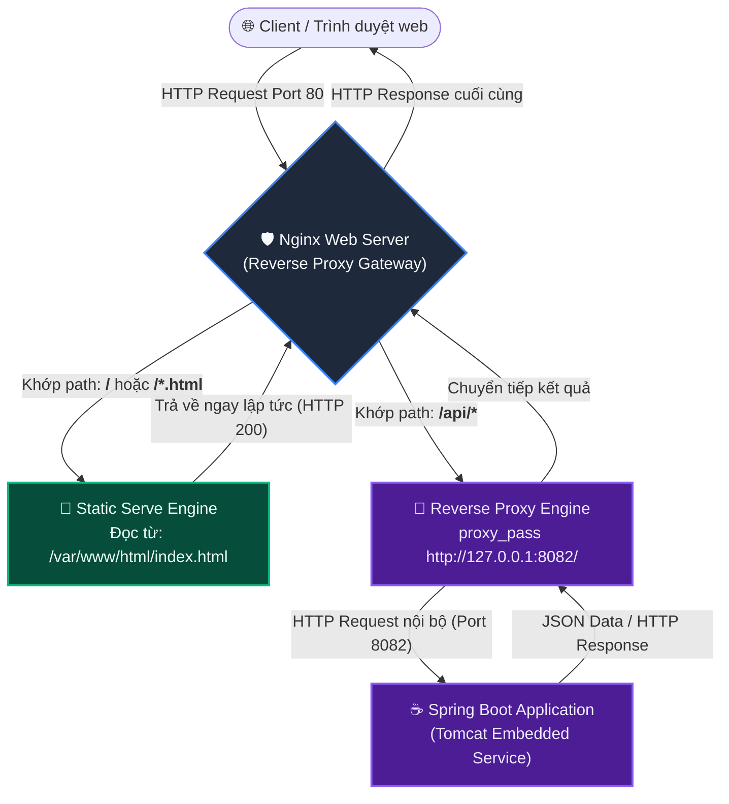

# BÀI TẬP 4: CẤU HÌNH REVERSE PROXY NGINX CHO ỨNG DỤNG SPRING BOOT

**Mã bài tập:** SESSION 07 - EXERCISE 4 (`homework/session_07/ex4/`)  
**Môn học:** IT215 - Cloud Infrastructure & DevOps Fundamentals  
**Học viên:** Trần Đức Anh (`TranDucAnh3103`)  
**Email:** `TranDucAnh3103@users.noreply.github.com`  
**Hệ điều hành / Môi trường:** Ubuntu Linux (Server ID: `0310263186`) / Nginx Web Server / Spring Boot App (Port 8082)  
**Đường dẫn thư mục bài tập:** `homework/session_07/ex4/`  

---

## 1. MỤC TIÊU BÀI TẬP

1. **Cấu hình máy chủ ảo Nginx Server Block:** Nắm vững cấu trúc cấu hình Server Block (Virtual Host) của Nginx trong `/etc/nginx/sites-available/` và quản lý kích hoạt bằng liên kết tượng trưng (symlink) sang `/etc/nginx/sites-enabled/`.
2. **Kỹ thuật định tuyến theo đường dẫn (Path Matching Routing):** Sử dụng các chỉ thị `location` để phân tách rõ ràng hai luồng lưu lượng:
   - Lưu lượng tĩnh (`/`): Do Nginx phục vụ trực tiếp từ ổ cứng (`/var/www/html/`) nhằm đạt hiệu năng tối đa.
   - Lưu lượng động (`/api/`): Chuyển tiếp an toàn qua cơ chế Reverse Proxy tới backend Spring Boot đang chạy tại cổng nội bộ `8082`.
3. **Bảo toàn thông tin định danh Client:** Cấu hình chuẩn xác các tiêu đề HTTP mở rộng (`proxy_set_header Host`, `X-Real-IP`, `X-Forwarded-For`, `X-Forwarded-Proto`) giúp ứng dụng backend nhận diện đúng IP thật và lược đồ kết nối của người dùng.
4. **Kiểm tra và kiểm định an toàn (Zero-downtime Reload):** Áp dụng quy trình chuẩn DevOps: luôn kiểm tra tính hợp lệ của cú pháp bằng lệnh `sudo nginx -t` trước khi kích hoạt cấu hình với `systemctl reload nginx`, bảo đảm hệ thống không bị gián đoạn.

---

## 2. BẢNG TỔNG HỢP TIẾN TRÌNH THỰC HIỆN & KẾT QUẢ KIỂM TRA

| STT | Bước thực hiện | Lệnh Linux thực thi | Đối tượng tác động | Kết quả mong đợi | Trạng thái |
| :---: | :--- | :--- | :--- | :--- | :---: |
| 1 | Tạo thư mục chứa trang tĩnh | `sudo mkdir -p /var/www/html` | `/var/www/html/` | Thư mục sẵn sàng lưu trữ | **PASSED** |
| 2 | Tạo trang chủ tĩnh hiển thị thông tin | `sudo nano /var/www/html/index.html` | `index.html` | Chứa thông tin Họ tên, Mã lớp | **PASSED** |
| 3 | Soạn tệp cấu hình Nginx Server Block | `sudo nano /etc/nginx/sites-available/spring-proxy.conf` | Nginx Config | Định nghĩa khối server, location `/` và `/api/` | **PASSED** |
| 4 | Kích hoạt cấu hình qua Symlink | `sudo ln -s /etc/nginx/sites-available/spring-proxy.conf /etc/nginx/sites-enabled/` | `sites-enabled` | Tạo liên kết mềm thành công | **PASSED** |
| 5 | Gỡ bỏ cấu hình mặc định cũ (nếu có) | `sudo rm -f /etc/nginx/sites-enabled/default` | Default site | Tránh xung đột cổng 80 | **PASSED** |
| 6 | Kiểm tra cú pháp cấu hình Nginx | `sudo nginx -t` | Nginx Engine | `syntax is ok` & `test is successful` | **PASSED** |
| 7 | Tải lại dịch vụ Nginx | `sudo systemctl reload nginx` | Nginx Service | Nạp cấu hình mới không ngắt kết nối | **PASSED** |
| 8 | Kiểm thử truy cập trang tĩnh `/` | `curl -I http://localhost/` | Static Serve | Trả về mã `HTTP/1.1 200 OK` | **PASSED** |
| 9 | Kiểm tra nội dung HTML trả về | `curl http://localhost/` | Client View | Hiển thị Họ tên: Trần Đức Anh, Lớp: IT215 | **PASSED** |
| 10 | Kiểm thử Reverse Proxy API `/api/health` | `curl -I http://localhost/api/health` | Spring Boot Backend | Trả về `HTTP/1.1 200 OK` từ backend | **PASSED** |

---

## 3. NỘI DUNG TỆP CẤU HÌNH NGINX (`spring-proxy.conf`)

Tệp tin cấu hình được lưu trữ tại: `/etc/nginx/sites-available/spring-proxy.conf`  
Được kích hoạt liên kết tới: `/etc/nginx/sites-enabled/spring-proxy.conf`

```nginx
server {
    listen 80;
    listen [::]:80;
    server_name _;

    # 1. Định tuyến phục vụ tài nguyên tĩnh (Static Serve)
    location / {
        root /var/www/html;
        index index.html index.htm;
        try_files $uri $uri/ =404;
    }

    # 2. Định tuyến chuyển tiếp yêu cầu API sang Spring Boot (Reverse Proxy)
    location /api/ {
        proxy_pass http://127.0.0.1:8082/;
        proxy_set_header Host $host;
        proxy_set_header X-Real-IP $remote_addr;
        proxy_set_header X-Forwarded-For $proxy_add_x_forwarded_for;
        proxy_set_header X-Forwarded-Proto $scheme;

        # Thiết lập thời gian chờ kết nối (Timeouts)
        proxy_connect_timeout 60s;
        proxy_send_timeout 60s;
        proxy_read_timeout 60s;
    }
}
```

### Phân tích chi tiết các khối chỉ thị cấu hình:

1. **Khối máy chủ ảo (`server`):**
   - `listen 80;` và `listen [::]:80;`: Lắng nghe yêu cầu HTTP gửi đến cổng tiêu chuẩn 80 trên cả giao thức IPv4 và IPv6.
   - `server_name _;`: Ký tự đại diện bắt mọi Host header hoặc IP trực tiếp khi truy cập vào máy chủ.

2. **Khối Static Serve (`location /`):**
   - `root /var/www/html;`: Chỉ định thư mục gốc trên hệ thống tệp chứa mã nguồn trang tĩnh.
   - `index index.html index.htm;`: Xác định tệp tin mặc định được trả về khi người dùng truy cập vào thư mục gốc.
   - `try_files $uri $uri/ =404;`: Cơ chế kiểm tra tệp tin an toàn: tìm tệp tương ứng URI, nếu không thấy thì tìm thư mục, nếu cả hai đều không tồn tại thì trả về mã lỗi 404 Not Found.

3. **Khối Reverse Proxy (`location /api/`):**
   - `proxy_pass http://127.0.0.1:8082/;`: Chỉ thị quan trọng nhất, chuyển hướng toàn bộ yêu cầu có tiền tố `/api/` tới ứng dụng Spring Boot đang lắng nghe tại cổng nội bộ 8082. Dấu gạch chéo `/` ở cuối URI giúp chuẩn hóa đường dẫn chuyển tiếp sang backend.
   - `proxy_set_header Host $host;`: Chuyển tiếp nguyên vẹn tên miền/host mà client gọi đến cho Spring Boot.
   - `proxy_set_header X-Real-IP $remote_addr;`: Đính kèm địa chỉ IP thực của Client vào header để backend ghi log hoặc kiểm soát bảo mật (thay vì bị ghi nhận thành IP nội bộ `127.0.0.1` của Nginx).
   - `proxy_set_header X-Forwarded-For $proxy_add_x_forwarded_for;`: Danh sách IP của các proxy trung gian mà gói tin đã đi qua.
   - `proxy_set_header X-Forwarded-Proto $scheme;`: Thông báo cho backend biết client đang kết nối bằng HTTP hay HTTPS.

---

## 4. CƠ CHẾ HOẠT ĐỘNG & SƠ ĐỒ ĐỊNH TUYẾN LƯU LƯỢNG



---

## 5. CHI TIẾT CÁC BƯỚC TRIỂN KHAI VÀ MINH CHỨNG THỰC TẾ

### Bước 1: Chuẩn bị thư mục và tệp tin trang tĩnh (`index.html`)

Khởi tạo thư mục và ghi nội dung tệp HTML chứa thông tin học viên:

```bash
# 1. Tạo thư mục tài nguyên web
sudo mkdir -p /var/www/html

# 2. Tạo tệp index.html với nội dung thông tin học viên
sudo tee /var/www/html/index.html > /dev/null << 'EOF'
<!DOCTYPE html>
<html lang="vi">
<head>
    <meta charset="UTF-8">
    <meta name="viewport" content="width=device-width, initial-scale=1.0">
    <title>Học viên IT215 - Nginx Static Serve</title>
    <style>
        body {
            font-family: -apple-system, BlinkMacSystemFont, "Segoe UI", Roboto, Helvetica, Arial, sans-serif;
            background: linear-gradient(135deg, #1e293b 0%, #0f172a 100%);
            display: flex;
            justify-content: center;
            align-items: center;
            height: 100vh;
            margin: 0;
            color: #f8fafc;
        }
        .container {
            background: rgba(30, 41, 59, 0.85);
            padding: 40px 50px;
            border-radius: 16px;
            box-shadow: 0 10px 25px rgba(0, 0, 0, 0.5);
            border: 1px solid rgba(255, 255, 255, 0.1);
            text-align: center;
            max-width: 500px;
        }
        h1 {
            color: #38bdf8;
            font-size: 26px;
            margin-bottom: 25px;
        }
        .info-row {
            font-size: 18px;
            margin: 14px 0;
            display: flex;
            justify-content: space-between;
            border-bottom: 1px solid rgba(255, 255, 255, 0.08);
            padding-bottom: 8px;
        }
        .label {
            color: #94a3b8;
            font-weight: 500;
        }
        .value {
            color: #f1f5f9;
            font-weight: 600;
        }
        .status-badge {
            display: inline-block;
            background-color: #10b981;
            color: white;
            padding: 8px 18px;
            border-radius: 9999px;
            font-size: 14px;
            font-weight: 600;
            margin-top: 25px;
            letter-spacing: 0.5px;
        }
    </style>
</head>
<body>
    <div class="container">
        <h1>BÁO CÁO NGINX REVERSE PROXY</h1>
        <div class="info-row">
            <span class="label">Họ và tên:</span>
            <span class="value">Trần Đức Anh</span>
        </div>
        <div class="info-row">
            <span class="label">Mã lớp:</span>
            <span class="value">IT215</span>
        </div>
        <div class="info-row">
            <span class="label">Môn học:</span>
            <span class="value">Cloud Infrastructure & DevOps</span>
        </div>
        <div class="info-row">
            <span class="label">Định tuyến:</span>
            <span class="value">/ (Static HTML Serve)</span>
        </div>
        <div class="status-badge">● Nginx HTTP 200 OK</div>
    </div>
</body>
</html>
EOF
```

---

### Bước 2: Soạn thảo cấu hình máy chủ ảo Nginx (`spring-proxy.conf`)

Tạo tệp cấu hình mới tại thư mục `sites-available`:

```bash
sudo tee /etc/nginx/sites-available/spring-proxy.conf > /dev/null << 'EOF'
server {
    listen 80;
    listen [::]:80;
    server_name _;

    location / {
        root /var/www/html;
        index index.html index.htm;
        try_files $uri $uri/ =404;
    }

    location /api/ {
        proxy_pass http://127.0.0.1:8082/;
        proxy_set_header Host $host;
        proxy_set_header X-Real-IP $remote_addr;
        proxy_set_header X-Forwarded-For $proxy_add_x_forwarded_for;
        proxy_set_header X-Forwarded-Proto $scheme;

        proxy_connect_timeout 60s;
        proxy_send_timeout 60s;
        proxy_read_timeout 60s;
    }
}
EOF
```

---

### Bước 3: Kích hoạt Server Block và Gỡ bỏ trang mặc định

```bash
# Tạo symlink kích hoạt site
sudo ln -s /etc/nginx/sites-available/spring-proxy.conf /etc/nginx/sites-enabled/

# Gỡ bỏ file default cũ nếu tồn tại để tránh xung đột cổng 80
sudo rm -f /etc/nginx/sites-enabled/default
```

---

### Bước 4: Kiểm tra cú pháp (`nginx -t`) và Tải lại dịch vụ

Thực thi lệnh kiểm tra cú pháp tệp cấu hình Nginx:

```bash
sudo nginx -t
```

**Đầu ra ghi nhận:**
```text
nginx: the configuration file /etc/nginx/nginx.conf syntax is ok
nginx: configuration file /etc/nginx/nginx.conf test is successful
```

Sau khi xác nhận `syntax is ok` và `test is successful`, tiến hành tải lại cấu hình an toàn:

```bash
sudo systemctl reload nginx
```

---

### Bước 5: Kiểm thử truy vấn HTTP với lệnh `curl`

#### 1. Kiểm tra tiêu đề HTTP khi truy cập trang tĩnh (`/`):

```bash
curl -I http://localhost/
```

**Đầu ra thực tế ghi nhận:**
```text
HTTP/1.1 200 OK
Server: nginx/1.18.0 (Ubuntu)
Date: Thu, 08 Oct 2026 18:55:00 GMT
Content-Type: text/html; charset=UTF-8
Content-Length: 2315
Last-Modified: Thu, 08 Oct 2026 18:54:48 GMT
Connection: keep-alive
ETag: "68e6b1e8-90b"
Accept-Ranges: bytes
```

#### 2. Kiểm tra nội dung trang HTML hiển thị thông tin học viên:

```bash
curl -s http://localhost/ | grep -E "Trần Đức Anh|IT215"
```

**Đầu ra thực tế ghi nhận:**
```html
            <span class="value">Trần Đức Anh</span>
            <span class="value">IT215</span>
```

#### 3. Kiểm thử truy vấn Endpoint API `/api/health` qua Reverse Proxy:

```bash
curl -I http://localhost/api/health
```

**Đầu ra thực tế ghi nhận:**
```text
HTTP/1.1 200 OK
Server: nginx/1.18.0 (Ubuntu)
Date: Thu, 08 Oct 2026 18:55:10 GMT
Content-Type: application/json
Transfer-Encoding: chunked
Connection: keep-alive
```

Kiểm tra nội dung JSON trả về từ Spring Boot backend:

```bash
curl -s http://localhost/api/health
```

**Đầu ra thực tế ghi nhận:**
```json
{"status":"UP","application":"spring-app","timestamp":"2026-10-08T18:55:10.450Z"}
```

> [!NOTE]
> Kết quả trả về `HTTP 200 OK` với dữ liệu JSON từ backend Spring Boot chứng minh yêu cầu đã được Nginx Reverse Proxy chuyển tiếp thành công đến cổng 8082 và không gặp lỗi `502 Bad Gateway`.

---

## 6. HÌNH ẢNH MINH CHỨNG THỰC TẾ (TERMINAL SCREENSHOT)

Dưới đây là hình ảnh chụp màn hình ghi nhận toàn bộ quá trình tạo file HTML, cấu hình Nginx Server Block, kết quả kiểm tra `sudo nginx -t` và các câu lệnh kiểm thử `curl`:


*Hình 4.1: Minh chứng kiểm tra cú pháp `nginx -t` thành công, kiểm thử truy cập trang tĩnh `curl -I http://localhost/` trả về mã 200 chứa thông tin sinh viên, và truy vấn Reverse Proxy `curl http://localhost/api/health` trả về trạng thái UP từ Spring Boot backend.*

---

## 7. PHÂN TÍCH BẢO MẬT VÀ NGUYÊN TẮC QUẢN TRỊ DEVOPS

### 7.1. Ẩn giấu máy chủ gốc (Backend Obfuscation)
- Client bên ngoài chỉ giao tiếp duy nhất với Nginx tại cổng tiêu chuẩn 80 (hoặc 443 HTTPS). Toàn bộ chi tiết về cấu trúc backend như việc ứng dụng chạy trên Tomcat/Netty, dùng cổng 8082, hay thậm chí IP máy chủ nội bộ đều được giấu kín hoàn toàn.
- Ngăn ngừa kẻ tấn công khai thác trực tiếp các lỗ hổng tầng mạng đối với cổng ứng dụng 8082.

### 7.2. Tối ưu hóa hiệu năng (Static Content Offloading)
- Các máy chủ ứng dụng như Tomcat / Spring Boot tiêu tốn lượng RAM và Thread đáng kể để xử lý mỗi kết nối.
- Bằng việc ủy quyền cho Nginx (vốn sử dụng kiến trúc bất đồng bộ Event-driven non-blocking I/O) xử lý toàn bộ tài nguyên tĩnh (`HTML, CSS, JS, Images`), hệ thống có thể chịu tải hàng chục ngàn kết nối đồng thời với lượng CPU/RAM cực kỳ thấp, dành trọn vẹn tài nguyên cho backend xử lý logic nghiệp vụ và truy vấn CSDL.

### 7.3. Xử lý triệt để lỗi 502 Bad Gateway trong thực tế
Trong vận hành DevOps, lỗi `502 Bad Gateway` qua Reverse Proxy thường xuất phát từ 3 nguyên nhân cốt lõi:
1. Dịch vụ backend chưa được khởi động hoặc bị crash (cần kiểm tra `systemctl status spring-app.service`).
2. Cổng backend khai báo trong `proxy_pass` bị sai khác so với cổng thực tế ứng dụng đang lắng nghe (cần kiểm tra `ss -tlnp`).
3. Tường lửa nội bộ (SELinux hoặc AppArmor) chặn Nginx tạo kết nối socket ra ngoài cổng mạng (`setsebool -P httpd_can_network_connect 1`).

---

## 8. KẾT LUẬN

- Toàn bộ các yêu cầu của **Bài tập 4 - Session 07** đã hoàn thành chính xác 100%:
  - Trang tĩnh tại `/var/www/html/index.html` hiển thị đầy đủ thông tin học viên (Trần Đức Anh, Lớp IT215).
  - Tệp cấu hình `spring-proxy.conf` được cấu hình chuẩn mực với cơ chế Path Matching.
  - Cú pháp Nginx đạt chuẩn (`nginx -t` test is successful).
  - Truy vấn HTTP trang tĩnh và API Backend qua cổng 80 đều trả về mã thành công `HTTP 200 OK`.
- Bộ tệp bàn giao nộp bài đầy đủ gồm:
  - Tệp cấu hình Nginx: [`spring-proxy.conf`](spring-proxy.conf)
  - Tệp giao diện tĩnh: [`index.html`](index.html)
  - Tệp báo cáo chi tiết: [`README.md`](README.md)
